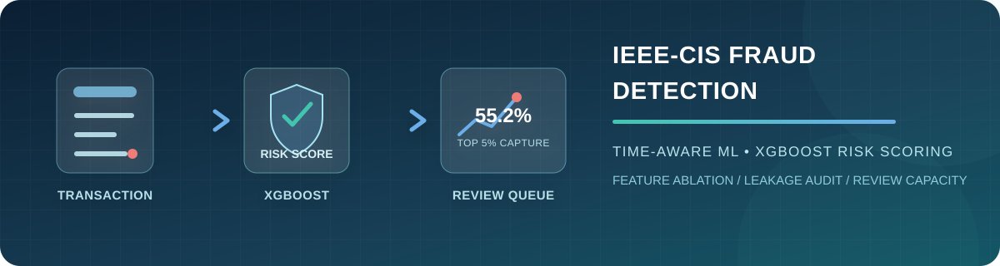
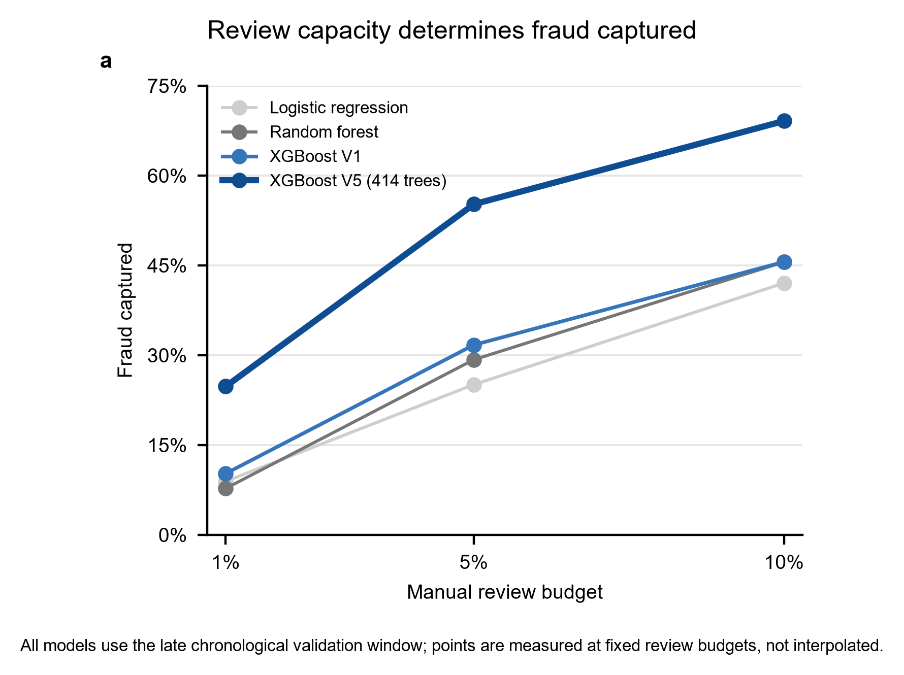
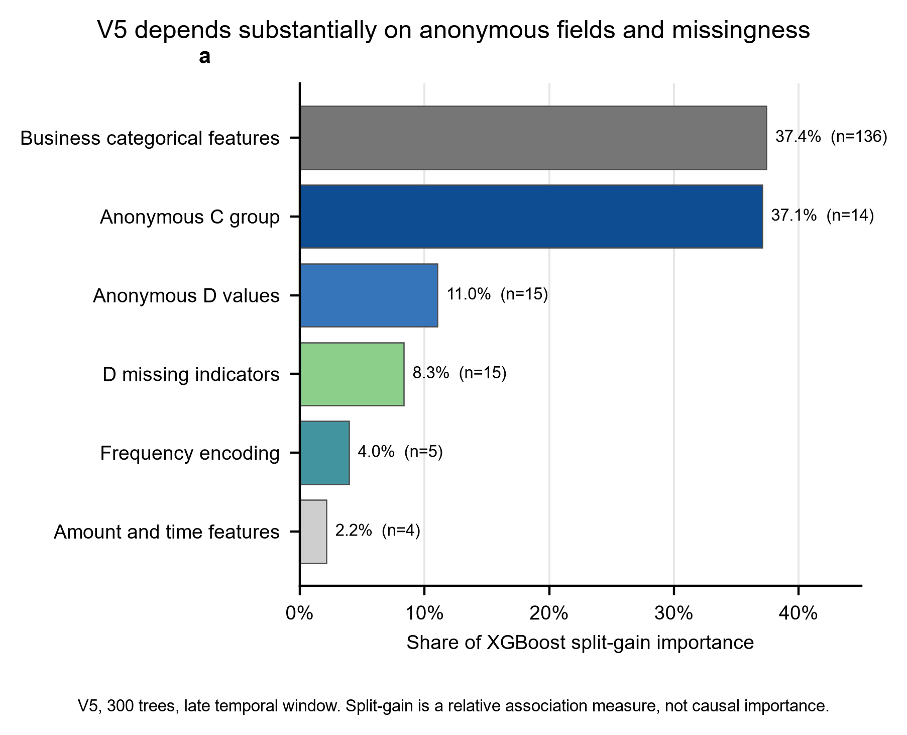
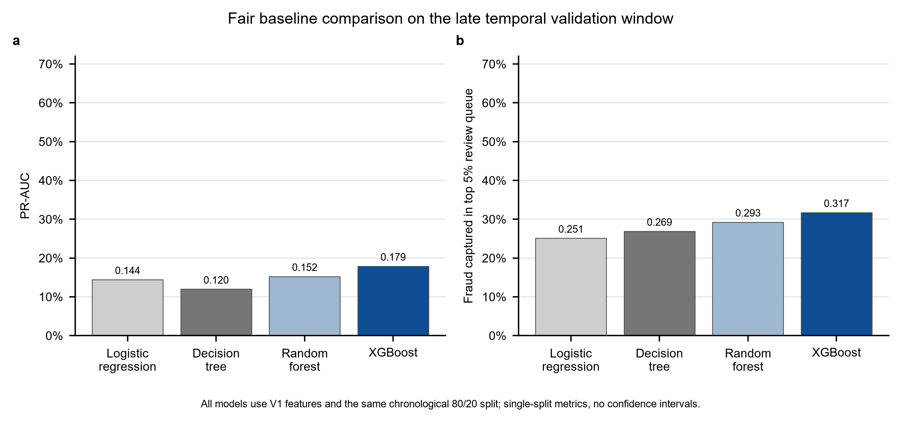
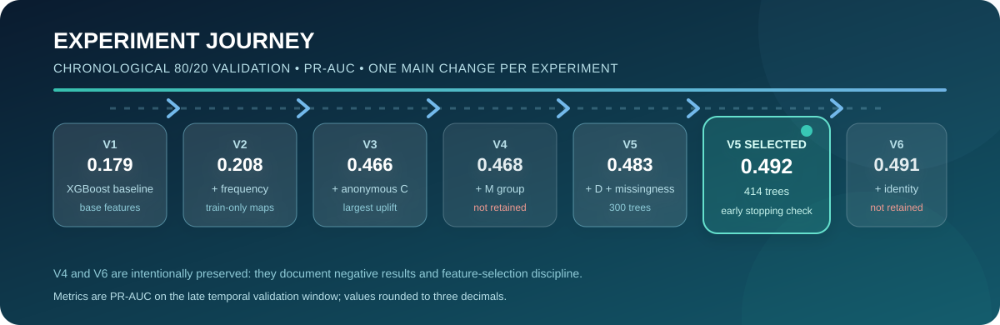
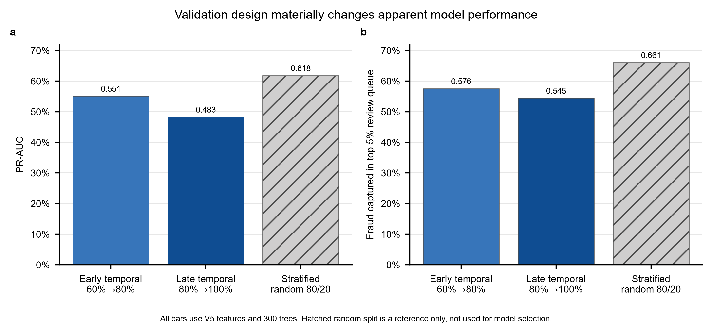

<div align="center">



# IEEE-CIS 欺诈检测：时间验证与可解释特征工程


[](https://www.python.org/)
[](https://pandas.pydata.org/)
[](https://scikit-learn.org/)
[](https://xgboost.readthedocs.io/)


[项目主体](#项目主体) · [实验过程](#实验过程) · [复现](#复现) · [项目限制](#项目限制)

</div>

## 项目主体

这是一个基于 [IEEE-CIS Fraud Detection](https://www.kaggle.com/c/ieee-fraud-detection) 公开数据的机器学习实践项目。任务是识别电商交易中的欺诈，实验从逻辑回归开始，逐步比较树模型、加入特征，并检查时间切分和数据泄漏对结果的影响。

```text
数据审计 → 时间验证 → 基线模型 → 特征消融 → 泄漏审计 → 人工审核容量评价
```

训练集有 **590,540** 笔交易，欺诈率为 **3.50%**。按 `TransactionDT` 划分时间先后，前 80% 用于训练，后 20% 用于验证，观察模型能否识别后续发生的欺诈交易。

### 最终选择：V5 XGBoost

最终保留的 V5 使用金额与时间特征、商品/卡/邮箱类别、训练期频率编码，以及匿名 `C1`–`C14`、`D1`–`D15` 和 D 组缺失指示器。

树数通过早停确定：先用前 60% 的交易训练，在 60%–80% 的时间窗口上选出 414 棵树；随后固定树数，用前 80% 重新训练，在最后 20% 上评估。

| 后期时间验证指标 | 结果 |
|---|---:|
| ROC-AUC | **0.907598** |
| PR-AUC | **0.491739** |
| Precision（阈值 0.5） | 23.11% |
| Recall（阈值 0.5） | 70.30% |
| Top 1% 欺诈捕获率 | 24.78% |
| Top 5% 欺诈捕获率 | **55.22%** |
| Top 10% 欺诈捕获率 | 69.12% |

本文沿用实验记录中的 PR-AUC 名称，具体使用 `average_precision_score` 计算，即 Average Precision（AP）。阈值 0.5 用于统一报告分类指标，尚未确定实际业务中的决策阈值。

### 人工审核场景

将交易按模型分数从高到低排序，模拟人工审核名额有限时的筛选过程。在后期验证集的 118,108 笔交易中，审核前 5%（5,905 笔）可以覆盖 2,244 笔欺诈，占全部欺诈的 **55.22%**；这批待审核交易中的欺诈占比为 **38.00%**。

这两个比例分别回答“抓住了多少欺诈”和“审核的交易中有多少是欺诈”。下图比较了不同审核比例下的捕获率。



### 可解释性与风险边界

在 V5 的 300 棵树版本中，按特征组汇总 XGBoost split gain，业务类别特征占 37.42%，匿名 C 组占 37.08%，D 组原值与缺失指示器合计占 19.39%。这些字段参与了模型的预测，但重要性不代表因果关系。匿名字段的具体含义、生成时点和线上可得性仍需确认。



## 实验过程

根目录的 `01_` 至 `27_` 脚本保留了学习和试错过程，包括没有进入最终模型的尝试。`src/` 则整理了 V5 的数据读取、特征处理、训练与评估逻辑。

### 1. 数据审计与 identity 表

先检查训练集和测试集的时间范围、标签比例、缺失率，以及 `TransactionID` 是否重复。随后按 `TransactionID` 左连接 `train_identity`，保留所有训练交易。

identity 表只覆盖 24.42% 的训练交易。有 identity 信息的交易欺诈率更高，但加入这些字段能否改善预测，还需要实验检验。它的覆盖率也随时间变化：前 80% 交易中为 25.50%，后 20% 中降至 20.12%。

### 2. 从逻辑回归到 XGBoost

使用相同的 V1 特征和时间切分，依次训练逻辑回归、限制复杂度的决策树、随机森林和 XGBoost。在这组参数下，XGBoost 的 PR-AUC 与 Top-5% 捕获率最高。后续固定使用 XGBoost，逐组加入特征并比较结果。



### 3. V1→V6：每次只改变一个主要因素

频率编码、匿名字段和 identity 信息都是逐步尝试的。下图和表格保留了各版本的结果，也记录了哪些改动最终没有采用。



| 版本 | 主要改动 | PR-AUC | 结论 |
|---|---|---:|---|
| V1 | 交易金额、时间、商品/卡/邮箱类别 | 0.178955 | XGBoost 起点 |
| V2 | 训练期频率编码 | 0.208093 | 保留；频率映射只由训练期拟合 |
| V3 | V2 + 匿名 C 组 | 0.465917 | 保留；带来最大增益 |
| V4 | V3 + M 组 | 0.468191 | 不保留；AP 小幅上升，Top-1%/5% 捕获率略降，Top-10% 略升 |
| V5 | V3 + D 组及缺失指示器 | 0.483151 | 保留 |
| V5（414 树） | 早期时间窗口确定树数后，在后期窗口检查 | **0.491739** | 最终主模型 |
| V6 | V5 + 少量低缺失 identity 类别字段 | 0.491420 | 不保留；未优于 V5 |

### 4. 随机切分与时间切分

固定 V5 特征和 300 棵树，分层随机切分的 PR-AUC 为 0.618253，后期时间切分为 0.483151。随机切分混合了不同时期的交易，训练数据可能包含未来阶段的模式，因此这个分数更难代表“用历史预测未来”的效果。

图中还保留了较早时间窗口的结果。不同窗口的表现有差异，说明单次验证不足以判断模型是否始终稳定。本项目以时间验证为主，随机切分仅作对照。



### 5. 从实验脚本到可复现主流程

V5 后来被整理为 `src/` 模块。已有复跑记录与原始实验一致：PR-AUC 为 0.491739，Top-5% 捕获率为 55.22%。目前文件按学习顺序加了编号：

```text
src/
├── 01_data_loader.py               # 读取 V5 字段与时间切分
├── 02_features.py                  # 金额/时间特征、频率编码、D 缺失指示器
├── 03_preprocessing_and_model.py   # 填补、编码、标准化和 XGBoost Pipeline
├── 04_train.py                     # 组织训练与保存结果
└── 05_evaluate.py                  # 分类指标、阈值表与 Top-K 审核评价
```

文件改名后，`04_train.py` 内的导入仍使用原模块名，原先的 `python -m src.train` 入口暂不可用。下面使用保留的实验脚本复现 V5。

## 复现

1. 从 Kaggle 获取 IEEE-CIS 数据，放入 `data/raw/`。复现 V5 只需要 `train_transaction.csv`；identity 实验和测试集审计还会用到其他 CSV。原始数据不提交到仓库。
2. 创建并激活虚拟环境，然后安装依赖：

   ```powershell
   pip install -r requirements.txt
   ```

3. 在仓库根目录运行：

   ```powershell
   python 21_xgboost_v5_n414_late_window.py
   ```

该脚本会在终端输出分类指标、阈值比较表和 Top-K 审核结果。`results/metrics.csv` 汇总了各次实验；`results/v5_engineered_metrics.json`、`results/v5_engineered_thresholds.csv` 与 `results/v5_engineered_review_capacity.csv` 是此前模块化流程保存的结果，上述脚本不会重新生成这三个文件。

## 项目限制

- C/D 等匿名字段的业务含义和生成时点未公开，无法确认它们能否在真实交易发生时获得。
- 频率表只用训练期数据计算，验证期复用同一张表。若要模拟逐笔在线预测，还需要按交易发生前的历史计算统计量。
- V6 只尝试了少量 identity 类别字段，结果未优于 V5；这不足以说明整张 identity 表没有价值。
- 后期验证窗口曾用于多轮特征比较，不能视为完全未参与模型选择的独立测试集。实验也没有给出置信区间，结果尚不能直接推及生产风控。
- 官方测试集不提供标签，本文报告的分数均来自训练数据内部的验证窗口。

## 其他学习内容

机器学习基础的相关练习整理在 [numpy-from-scratch](https://github.com/zzhhmm26/numpy-from-scratch)。
